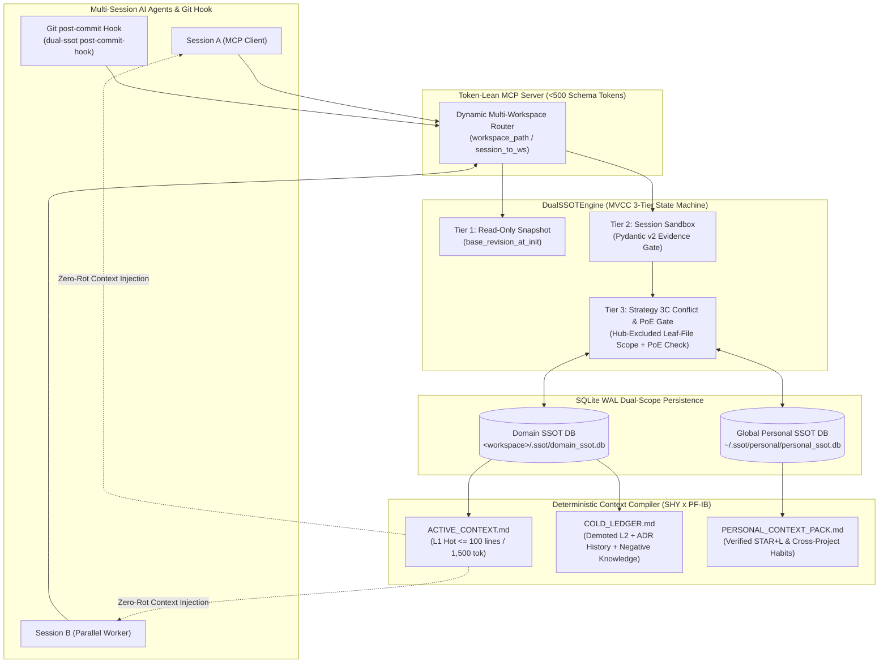
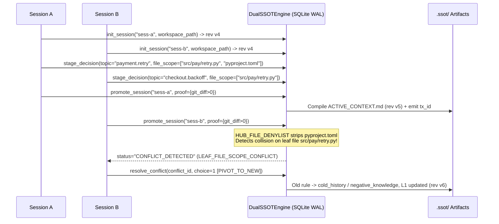

# 🧠 agent-dual-SSOT — 결정론적 MVCC 에이전트 상태 원장 & 컨텍스트 컴파일러 MCP 서버

[](./pyproject.toml)
[-111827)](./src/dual_ssot/mcp_server.py)
[](./src/dual_ssot/db.py)
[](./src/dual_ssot/models.py)
[](./pyproject.toml)

> **멀티 에이전트·장기 코딩 세션에서 발생하는 컨텍스트 부패(`Context Rot`), 병렬 세션 간 무음 덮어쓰기(`Multi-Session Split-Brain`), 프로젝트 종료 후 엔지니어링 지식 증발을 원천 차단하는 결정론적 MVCC 상태 원장 및 컨텍스트 컴파일러(`MCP Server + CLI + Git Hook`)입니다.**

---

## 1. Why — 배경 및 해결하려는 문제

LLM 코딩 에이전트와 서브에이전트 스웜을 실제 프로덕션 저장소에서 장기간 운용하면 기존 마크다운 메모리(`MEMORY.md`, 채팅 요약 덤프) 방식은 세 가지 결정적 한계에 부딪힙니다.

1. **컨텍스트 부패 (`Context Rot` & 주의력 희석)**: 세션마다 노트를 끝없이 덧붙이면 수천 토큰의 죽은 규칙과 상충하는 과거 결정이 L1 프롬프트를 점유해 추론 정확도가 급락하고 매 턴 토큰 비용이 누적됩니다.
2. **병렬 세션 Split-Brain 및 허브 파일 오탐 (`False Sharing`)**: 두 개의 병렬 에이전트 세션이 서로 다른 토픽 이름으로 동일한 리프 비즈니스 로직 파일(예: `src/payment/retry.py`)의 전제를 변경해도 기존 키-값 메모리는 충돌을 감지하지 못하며, 반대로 단순 파일 락을 걸면 `package.json`·`pyproject.toml` 같은 공용 허브 파일 때문에 모든 병렬 작업이 멈춥니다.
3. **말뿐인 환각 기록(`Chat-Dump Pollution`) 및 경험 증발**: 실제 파일 수정이나 테스트 통과 증거 없이 `"tbd"`, `"todo"` 수준의 미검증 가설이 사실처럼 승격(Goodhart's Law)되고, 기각된 실패 가설(`Negative Knowledge`)이 남지 않아 후속 에이전트가 동일한 시행착오를 반복합니다.

**`agent-dual-SSOT`**는 에이전트 메모리를 자유 서술형 노트가 아닌 **SQLite WAL 기반 MVCC 트랜잭션 원장 + 정보이론적 L1 캐시 컴파일러**로 재정의하여 이 세 가지 문제를 결정론적으로 해결합니다.

---

## 2. What — 핵심 기능 및 아키텍처 불변식

### ① `Proof-of-Execution` 기반 무결성 승격 게이트
- **Tier 2 스키마 검문 (`Pydantic v2`)**: `stage_decision` 및 `record_rejected_hypothesis` 호출 시 빈 근거 또는 더미 증거(`"tbd"`, `"todo"`, `"trust me"`, `"none"`)를 경계면에서 즉시 기각합니다.
- **Tier 3 실행 증명 (`promote_session`)**:
  - **Domain SSOT 승격**: `ProofOfExecution(file_exists=True, git_diff_changed_lines > 0)` 충족 필수.
  - **Personal SSOT (`STAR+L`) 승격**: 더미 수정을 막기 위해 `test_exit_code == 0`까지 검증된 실행 증명과 정량 지표(`result_metric`)가 동반될 때만 즉시($N=1$) 승격합니다.

### ② `SHY × PF-IB` 5변수 라그랑주 점수 기반 L1 컨텍스트 컴파일러 (`100줄 / 1,500 토큰 캡`)
- 로컬 워크스페이스의 L1 핫 컨텍스트(`.ssot/ACTIVE_CONTEXT.md`)가 **100줄 또는 1,500 토큰**을 절대 초과하지 않도록 결정론적으로 컴파일합니다.
- 용량 초과 시 단순 LRU가 아니라 시냅스 항상성 감쇠(`SHY`)와 과거-미래 정보 병목(`PF-IB`)을 결합한 **5변수 라그랑주 효용 점수**가 가장 낮은 비고정(`[ACT]`) 규칙부터 L2 Cold Ledger(`COLD_LEDGER.md`)로 강등하고 하단에 1줄 `[COLD_INDEX]` 포인터를 남깁니다:

$$J_{\text{PF-IB}}(i) = \beta \cdot \exp(-\lambda_{\text{eff}} \Delta t_i) \cdot p_{\text{reuse}}(i) \cdot \Delta H_{\text{impact}}(i) - I_{\text{past}}(i)$$

  - $\Delta t_i$: 경과 일수(`wall_days`) + 인과 스텝 드리프트 $0.05 \times (s_{\max} - s_i)$
  - $w_i = \exp(-\lambda_{\text{eff}} \Delta t_i)$: 핵심 불변식(`[PIN]` 및 코어 아키텍처 프리픽스)은 감쇠율을 $0.25\lambda$로 보호
  - $p_{\text{reuse}}(i), \Delta H_{\text{impact}}(i)$: 개정 횟수(`version`) 및 아키텍처 도메인 프리픽스 기반 미래 재사용 확률과 의사결정 엔트로피 감소량(bits)
  - $I_{\text{past}}(i)$: 해당 규칙이 L1 프롬프트에서 차지하는 토큰 비용

### ③ MVCC 3-Tier 세션 격리 & `Strategy 3C` 리프 파일 충돌 게이트
- **30개 코어 정준 템플릿 + 동적 브로드캐스트**: 초기화 시 30개 표준 아키텍처 키(`arch.*`, `db.*`, `auth.*`, `api.*` 등)를 시드하고, 신규 `domain.subtopic` 키는 차단 없이 자동 브로드캐스트합니다(150개 자동 키 킬스위치 내장).
- **허브 파일 제외 리프 스코프 충돌 검출 (`HUB_FILE_DENYLIST`)**: `package.json`, `pyproject.toml`, `Cargo.toml`, `__init__.py`, `config.*` 등 39종 공용 허브 파일은 제외하고, 실제 도메인 로직을 담은 **리프 파일 교집합 충돌(`LEAF_FILE_SCOPE_CONFLICT`)**만 정밀 포착합니다.
- **3-Way 강제 해결 (`resolve_conflict`)**: 충돌 감지 시 무음 덮어쓰기를 차단하고 ① `PIVOT_TO_NEW`(신규 채택 + 구버전 `cold_history` 이관 + 경쟁안 `negative_knowledge` 보존), ② `KEEP_AS_BRAINSTORM`, ③ `ARCHIVE_AS_NEGATIVE_KNOWLEDGE` 중 하나로 명시적 합의를 강제합니다.

### ④ Dual-Scope 라우팅 (`Domain SSOT` ↔ `Personal SSOT`) & 원자적 롤백
- 프로젝트 종속 결정(`.ssot/domain_ssot.db`)과 프로젝트 간 이식 가능한 엔지니어링 자산(`~/.ssot/personal/personal_ssot.db`)을 분리하며, UI 헥스 코드·로컬 테이블명 등 도메인 노이즈가 개인 원장에 오염되는 것을 정규식/구조 필터로 차단합니다.
- 코딩 습관(`coding_habits`)은 최소 $K_{\min}$개 이상의 서로 다른 프로젝트에서 반복 관찰되기 전까지 `CANDIDATE` 상태로 격리합니다.
- 모든 승격 트랜잭션은 사전 스냅샷을 `transaction_log`에 기록하고 2줄 영수증(`[SSOT Receipt]` + `tx_id`)을 반환하여 `rollback_transaction(tx_id)` 한 번으로 Domain·Personal 양쪽 상태를 원자적으로 복원합니다.

---

## 3. How — 시스템 아키텍처 및 데이터 흐름

### 3.1 전체 아키텍처 다이어그램



### 3.2 병렬 세션 충돌 감지 및 원자적 승격 시퀀스



### 3.3 SQLite WAL 스키마 요약

#### Local Domain SSOT (`<workspace>/.ssot/domain_ssot.db`)
| 테이블명 | 기본키 | 역할 |
| :--- | :--- | :--- |
| `ssot_meta` | `key` | `base_revision`, `step_clock`, `project_id` 메타 상태 추적 |
| `canonical_keys` | `topic_key` | 30개 코어 정준 키 + Strategy 3C 동적 등록 키 관리 |
| `base_decisions` | `topic_key` | `L1_HOT` / `L2_COLD` 확정 규칙, `pinned`, `version`, `leaf_files_json` |
| `cold_history` | `id` | 덮어써진 구버전 의사결정(`old_value -> new_value`) 시계열 보존 |
| `negative_knowledge` | `id` | 기각된 가설·기각 사유·채택 대안(`[DO_NOT_REPEAT]`) 영구 기록 |
| `sessions` / `staged_decisions` | `session_id` / `id` | MVCC 세션 스냅샷 버전 및 Tier 2 격리 샌드박스 |
| `conflicts` | `conflict_id` | 키 값 충돌·구버전 스냅샷·리프 파일 범위 충돌 레코드 |
| `transaction_log` | `tx_id` | 원자적 `rollback_transaction`을 위한 Domain + Personal 변경 전 스냅샷 |

#### Global Personal SSOT (`~/.ssot/personal/personal_ssot.db`)
| 테이블명 | 기본키 | 역할 |
| :--- | :--- | :--- |
| `starl_achievements` | `id` | `ProofOfExecution`(`test_exit_code == 0`)으로 검증된 `STAR+L` 엔지니어링 성과 |
| `coding_habits` | `habit_key` | 다중 프로젝트 관찰(`CANDIDATE` → `ACTIVE`)을 거친 범용 메타 코딩 원칙 |

### 3.4 디렉토리 및 핵심 모듈 구조

```text
agent-dual-SSOT/
├── pyproject.toml                 # 패키지 메타데이터 및 CLI 엔트리포인트 (dual-ssot, dual-ssot-mcp)
├── src/dual_ssot/
│   ├── models.py                  # Pydantic v2 엄격 모델, 30개 코어 키, HUB_FILE_DENYLIST, 도메인 오염 필터
│   ├── db.py                      # SQLite WAL 커넥션 및 Domain/Personal 스키마 초기화
│   ├── compiler.py                # SHY × PF-IB 5변수 라그랑주 L1 컴파일러 및 마크다운 렌더러
│   ├── engine.py                  # MVCC 3-Tier 상태 머신, Strategy 3C 충돌 탐지, 트랜잭션 롤백 엔진
│   ├── mcp_server.py              # <500 스키마 토큰 경량 MCP 서버 (다중 워크스페이스 동적 라우팅)
│   ├── cli.py                     # CLI 유틸리티 및 비침투적 Git post-commit 훅 브릿지
│   └── metrics.py                 # 컨텍스트 토큰 ROI, 충돌 탐지 ROI 및 Strategy 1~3C 시뮬레이터
├── templates/
│   ├── AGENTS.md                  # 에이전트 시스템 프롬프트용 3-Step 프로토콜 템플릿
│   └── post-commit                # 확률적 에이전트 호출 누락을 보완하는 Git post-commit 훅 스크립트
└── tests/
    └── test_dual_ssot.py          # MVCC 격리, 라그랑주 강등, 충돌 해결, 롤백 전수 단위 테스트
```

---

## 4. Quick Start — 로컬 설치·실행·테스트 및 MCP 연동

### 4.1 로컬 설치 및 테스트 실행

```bash
git clone https://github.com/tejo1990/agent-dual-SSOT.git
cd agent-dual-SSOT

# 가상환경 생성 및 개발 의존성 포함 설치 (Python 3.10+)
python -m venv .venv
# Windows PowerShell:
.venv\Scripts\Activate.ps1
# macOS / Linux:
# source .venv/bin/activate

pip install -e ".[dev]"

# 전체 단위 테스트 스위트 실행
pytest
```

### 4.2 CLI 및 Git Hook 브릿지 즉시 실행

```bash
# 1. 현재 워크스페이스의 Base SSOT 리비전 및 활성 규칙/기각 가설 수 조회
dual-ssot --workspace . status

# 2. 글로벌 Personal SSOT (STAR+L 포트폴리오 & 검증된 코딩 습관) 마크다운 팩 내보내기
dual-ssot --workspace . export-personal

# 3. 특정 트랜잭션 원자적 롤백
dual-ssot --workspace . rollback --tx-id tx_example123

# 4. (선택) Git post-commit 자동 승격 훅 설치
cp templates/post-commit .git/hooks/post-commit
chmod +x .git/hooks/post-commit
```

### 4.3 MCP 서버 등록 (`Claude Code` / `Cursor` / `Google Antigravity`)

`mcp_config.json` 또는 `.cursor/mcp.json`에 아래와 같이 등록하면 단일 MCP 프로세스로 여러 워크스페이스(`workspace_path` 인자 자동 라우팅)를 동시에 관리할 수 있습니다.

```json
{
  "mcpServers": {
    "dual-ssot": {
      "command": "dual-ssot-mcp",
      "env": {
        "DUAL_SSOT_WORKSPACE": "/path/to/default/workspace"
      }
    }
  }
}
```

### 4.4 제공 MCP Tool 인터페이스 (`<500 Schema Tokens`)

1. `init_session(session_id, workspace_path?)`: MVCC 읽기 스냅샷 초기화 및 L1 컨텍스트·정준 키 목록 반환
2. `stage_decision(...)`: Tier 2 샌드박스에 근거 기반 의사결정 스테이징 및 신규 키 자동 브로드캐스트
3. `record_rejected_hypothesis(...)`: 기각된 가설(`Negative Knowledge`) 및 사유를 L2 원장에 영구 기록
4. `promote_session(session_id, proof?, allow_overwrite?, workspace_path?)`: 충돌·실행 증명 게이트 통과 후 승격 및 2줄 영수증 반환
5. `resolve_conflict(conflict_id, choice, rejection_reason?, workspace_path?)`: 3-Way 충돌 해결(`1=Pivot`, `2=Brainstorm`, `3=Archive Negative`)
6. `query_cold_ledger(topic_key?, search_query?, workspace_path?)`: L2 강등 규칙·과거 ADR 이력·기각 가설 검색
7. `export_personal_pack(output_dir?)`: 글로벌 Personal SSOT 마크다운/JSON 컴파일 내보내기
8. `rollback_transaction(tx_id, workspace_path?)` *(별칭: `rollback`)*: `tx_id` 시점 이전으로 Domain·Personal 상태 원자적 복원

---

## 5. 라이선스 (License)

MIT License
